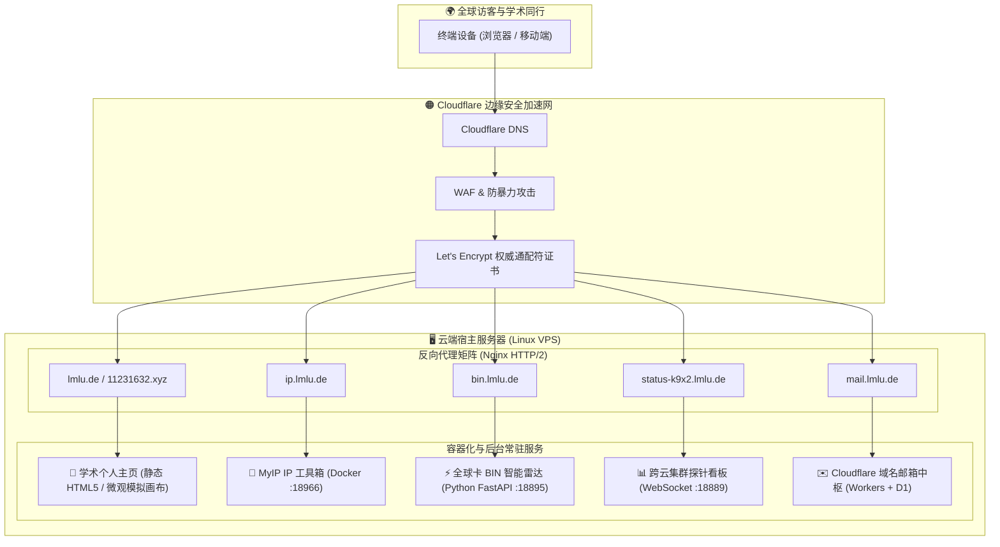

# 🌐 Minglu Lin's Personal Website & Cloud Services Hub

<div align="center">

[](LICENSE)
[](https://nginx.org)
[](https://www.docker.com)
[](https://www.cloudflare.com)
[](https://python.org)

**统一容灾管理与自动化热迁移中枢：个人学术主页、MyIP 工具箱及全套自建云端服务。**

[English](README.md) | [容灾恢复手册](docs/DISASTER_RECOVERY_PLAYBOOK.md) | [域名变更指南](docs/DOMAIN_MIGRATION_PLAYBOOK.md)

</div>

---

## 📖 项目简介 (Overview)

本项目是博主（**Minglu Lin / 林明鲁**）个人网站体系的**单点真实源（Single Source of Truth）与容灾同步中心**。

为了防范云厂商 VPS 突发封锁/失联、原生 IP 被风控，或因品牌演进导致的域名变更，本项目将此前分散在多个独立仓库与服务器本地的服务（包括学术主页、**MyIP 全功能 IP 工具箱**、全球卡 BIN 智能雷达、集群探针大盘等）统一纳入规范化 Monorepo 体系管理。

配合内置的 **自动化域名切换工具** 与 **一键冷迁移脚本**，任何时间节点均可在 **5 分钟内** 在任意全新 VPS 上实现全站无损拉起与无缝切换。

---

## 🏛️ 系统架构 (Architecture)



---

## 🧰 纳入的核心服务矩阵 (Service Matrix)

| 目录模块 | 对应服务 | 二级域名 | 技术栈 | 说明与亮点 |
| :--- | :--- | :--- | :--- | :--- |
| [`sites/homepage`](sites/homepage) | **学术主页主站** | `lmlu.de` / `11231632.xyz` | HTML5 / CSS3 / ES6 | 纯静态零构建依赖、中英一键切换、原子位错交互模拟、BibTeX 论文引用 |
| [`apps/myip`](apps/myip) | **MyIP 工具箱** | `ip.lmlu.de` | Docker / Node.js | 多源 IP 归属地、家宽/机房判别、0-100欺诈风控分、WebRTC/DNS 泄露审计 |
| [`apps/card-bin-lookup`](apps/card-bin-lookup) | **全球卡 BIN 雷达** | `bin.lmlu.de` | FastAPI / SQLite / JS | 10 位高精卡 BIN 穿透解析、发卡行/卡种判别、本地高命中持久缓存 |
| [`apps/fleet-status-monitor`](apps/fleet-status-monitor) | **集群遥测探针** | `status-k9x2.lmlu.de` | Python / WS / Chart | 跨云多机队实时遥测、CPU/RAM/丢包率大盘、隐蔽二级域名 + HTTP Basic Auth |
| [`apps/cloudflare-domain-mail`](apps/cloudflare-domain-mail) | **云域名邮箱** | `mail.lmlu.de` | CF Workers / Rust WASM | 全前缀域名收发、验证码智能提取、附件云端解析与轻量控制台 |
| [`sites/camouflage`](sites/camouflage) | **极客伪装页** | - | HTML5 | VPS 应急备用与节点伪装站点 |

---

## ⚡ 极速冷启动与灾难迁移 (Disaster Recovery)

若原 VPS 发生物理损坏、IP 被封锁或云服务商销毁实例，在新服务器上仅需运行一行命令：

```bash
curl -fsSL https://raw.githubusercontent.com/minglu-lin/personal-website/main/scripts/one-key-restore.sh | sudo bash -s -- lmlu.de
```

该脚本将自动完成：
1. 安装 Docker、Docker Compose、Nginx、Git 与 Python 依赖；
2. 递归拉取本仓库及所有 Submodule 源码；
3. 一键拉起 MyIP 容器及本地后台服务；
4. 部署与装载 Nginx 反向代理配置；
5. 服务自检并输出访问地址。

> 详见完整操作步骤：[🛡️ 灾难恢复与快速迁移手册](docs/DISASTER_RECOVERY_PLAYBOOK.md)

---

## 🔄 一键域名平滑切换 (Domain Switcher)

更换域名无需手动编辑多处文件，直接执行随附的 Python 工具：

```bash
# 1. 模拟预览替换处数 (安全无损)
python scripts/switch-domain.py --from 11231632.xyz --to lmlu.de --dry-run

# 2. 正式批量替换全站链接与 Nginx 虚拟主机配置
python scripts/switch-domain.py --from 11231632.xyz --to lmlu.de
```

> 详见完整迁移策略：[🌐 域名变更与 Cloudflare 配置指南](docs/DOMAIN_MIGRATION_PLAYBOOK.md)

---

## 📂 目录结构规范

```text
personal-website/
├── README.md                          # 全局项目说明与架构图
├── LICENSE                            # MIT 开源许可证
├── .gitignore                         # 严格凭据脱敏规则
├── docker-compose.yml                 # 聚合容器编排配置
├── sites/                             # 网页静态源码
│   ├── homepage/                      # 个人学术主页核心资产 (HTML/CSS/JS/Assets)
│   └── camouflage/                    # 应急伪装网站
├── apps/                              # 纳入的自建与聚合服务
│   ├── myip/                          # MyIP 工具箱 (Docker 编排 + Nginx + Submodule)
│   ├── card-bin-lookup/               # 卡 BIN 智能雷达系统源码
│   ├── fleet-status-monitor/          # 跨云机队探针大盘与客户端
│   ├── cloudflare-domain-mail/        # 域名邮箱 Web 界面与配置模板
│   └── scihub-batch-downloader/       # 文献批量检索直通平台
├── deploy/                            # 生产反代与服务守护
│   ├── nginx/conf.d/                  # 模块化 Nginx 虚拟主机配置 (01~05)
│   └── systemd/                       # Systemd 后台常驻守护进程
├── scripts/                           # 自动化运维工具箱
│   ├── one-key-restore.sh             # 新机一键冷部署脚本
│   └── switch-domain.py               # 全站域名一键切换器
└── docs/                              # 运维操作手册
    ├── DISASTER_RECOVERY_PLAYBOOK.md  # 灾难快速恢复演练
    └── DOMAIN_MIGRATION_PLAYBOOK.md   # 域名切换与 DNS 规范
```

---

## 📄 开源许可证 (License)

本项目采用 [MIT License](LICENSE) 开源。
纳入的开源子项目（如 MyIP）版权归各自原作者所有。
