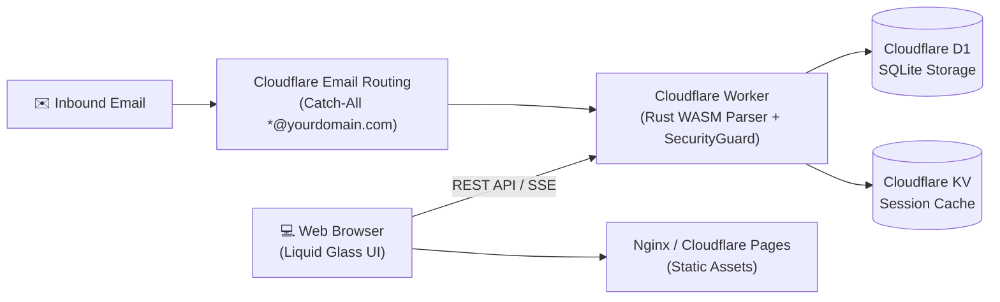

# 📧 Cloudflare Custom Domain Email Hub

Production-ready, serverless custom domain email platform powered by **Cloudflare Email Routing**, **Cloudflare Workers (Rust WASM MIME parser)**, **Cloudflare D1 (SQLite)**, and **Cloudflare KV**. Features a custom Liquid Glass glassmorphism UI, dual mailbox modes (permanent password-secured accounts + disposable temp mail), and automated brute-force defense alerts.

English | [中文说明](#中文说明)

---

## 🌟 Highlights

- **⚡ Truly Serverless & Low Latency**: 100% hosted on Cloudflare's global edge network. Zero server maintenance, zero inbound SMTP port 25 blocking issues.
- **🛡️ Dual Mailbox Modes**:
  - **🔐 Personal Password Mailbox**: Register persistent custom-prefix mailboxes protected by individual passwords. Isolated session storage prevents any cross-talk.
  - **⚡ Instant Disposable Temp Mail**: Generate one-click random inboxes with zero registration and 5-second real-time polling.
- **🦀 Rust WASM MIME Parser**: High-performance streaming email parsing with automatic OTP verification code detection and attachment processing.
- **🚨 SecurityGuard Brute-Force Defense**: Built-in failed attempt rate-limiter. Automatically dispatches security warning emails via Cloudflare Email Routing upon repeated login failures.
- **💎 Liquid Glass UI**: Modern glassmorphism frontend with dark/light harmony, responsive layout, and bilingual EN/ZH support.
- **🔧 Administrative Dashboard**: Comprehensive `/admin` control center for managing addresses, auditing catch-all inboxes, and viewing telemetry.

---

## 🏗️ Architecture



---

## 🚀 Quick Deployment Guide

### Prerequisites
- A domain delegated to Cloudflare DNS.
- Cloudflare API Token with `Account.D1`, `Account.Workers KV Storage`, `Account.Workers Scripts`, and `Zone.Email Routing` permissions.

### Step 1: Clone Repository
```bash
git clone https://github.com/minglu-lin/cloudflare-domain-mail.git
cd cloudflare-domain-mail
```

### Step 2: Configure Environment
Copy `.env.example` to `.env`:
```bash
cp .env.example .env
```
Fill in your credentials:
```ini
CLOUDFLARE_API_TOKEN=your_token_here
CLOUDFLARE_ACCOUNT_ID=your_account_id_here
CLOUDFLARE_ZONE_ID=your_zone_id_here
DOMAIN_NAME=yourdomain.com
ADMIN_PASSWORD=YourStrongPassword!
```

### Step 3: Deploy via Wrangler
```bash
cd worker
npm install -g wrangler
wrangler d1 create cloudflare_temp_email
wrangler kv:namespace create cloudflare_temp_email_kv

# Execute database schema
wrangler d1 execute cloudflare_temp_email --file=schema.sql

# Deploy worker
wrangler deploy
```

### Step 4: Host Frontend
Serve `frontend/index.html` via Cloudflare Pages, Vercel, or your existing Nginx web server using the template in `nginx/mail.conf`.

---

<a name="中文说明"></a>
## 🇨🇳 中文说明

基于 **Cloudflare Email Routing**、**Workers (Rust WASM 邮件解析)**、**D1 SQLite** 和 **KV** 构建的无服务器企业级域名邮箱系统。

### 核心特性
1. **全域名 Catch-All 实时接收入站邮件**：通过 Cloudflare 边缘节点直接路由，彻底避开云服务商封禁 25 端口的痛点。
2. **专属密码邮箱与极速临时邮箱双模式**：
   - 支持创建自定义前缀与独立登录密码的长期专属邮箱；
   - 支持免注册秒级生成当前标签页独享的随机一次性邮箱。
3. **Rust WASM 高性能解析引擎**：极速解析复杂 MIME 结构、内嵌图片与附件，智能提取邮件验证码 (OTP)。
4. **防暴破安全监控 (SecurityGuard)**：连续多次密码验证错误触发告警，自动发送异常登录安全审计邮件。
5. **透明液态玻璃质感前台**：高颜值玻璃拟态响应式界面，完美适配手机与桌面端。

---

## 📄 License

Licensed under the [MIT License](LICENSE).
