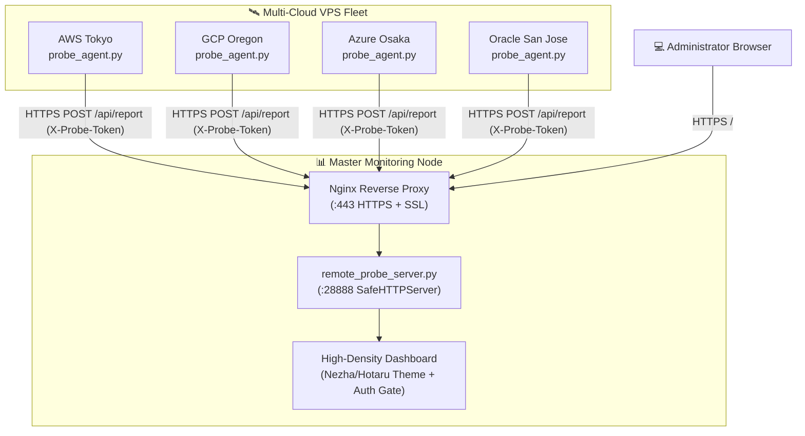

# 📊 Fleet Status Monitor

Ultra-lightweight, privacy-first server status and telemetry monitoring dashboard for multi-cloud VPS fleets (Nezha / Hotaru style). Built with pure Python standard libraries (zero third-party dependencies) and modern glassmorphism web UI.

English | [中文说明](#中文说明)

---

## 🌟 Highlights

- **🪶 Zero Dependencies**: Master server and client agent both run on Python 3 standard library. No psutil compilation, no external binaries, near-zero RAM footprint (<15MB).
- **🛡️ Privacy & Stealth First**:
  - Mask real public IPv4/IPv6 addresses behind anonymous node badges and custom geolocation pins.
  - Built-in session authentication gate (`/login`) preventing unauthorized scanning or reconnaissance.
- **⚡ Real-time Telemetry Streaming**:
  - CPU usage, RAM utilization, real-time RX/TX network bandwidth speeds, monthly data transfer volume, 1m/5m load averages, and uptime.
- **🗺️ Interactive World Fleet Map**: Embedded SVG vector world map plotting global multi-cloud node distribution and ping latencies.
- **🐧 Multi-Cloud Fleet Friendly**: Designed for cross-cloud topologies (AWS, GCP, Azure, Oracle Cloud, Linode, DigitalOcean, Hetzner, etc.).

---

## 🏗️ Architecture



---

## 🚀 Deployment Guide

### 1. Master Server Setup
```bash
git clone https://github.com/minglu-lin/fleet-status-monitor.git /opt/fleet-status-monitor
cd /opt/fleet-status-monitor

# Configure environment
cp .env.example .env
cp config/nodes.example.json config/nodes.json

# Edit config/nodes.json with your desired node names and flags
nano config/nodes.json

# Start Master Server
python3 server/remote_probe_server.py
```

### 2. Configure Nginx Reverse Proxy
Copy `nginx/probe.conf` to `/etc/nginx/sites-available/probe.conf`, edit the domain, and reload Nginx:
```bash
sudo ln -s /etc/nginx/sites-available/probe.conf /etc/nginx/sites-enabled/
sudo nginx -t && sudo systemctl reload nginx
```

### 3. Client Agent Setup (On each satellite node)
Copy `agent/probe_agent.py` to target VPS:
```bash
sudo mkdir -p /opt/fleet-probe-agent
sudo cp agent/probe_agent.py /opt/fleet-probe-agent/
sudo cp agent/systemd/fleet-probe-agent.service /etc/systemd/system/

# Edit service environment variables
sudo nano /etc/systemd/system/fleet-probe-agent.service
# Set PROBE_NODE_ID, PROBE_SERVER_URL, and PROBE_TOKEN

sudo systemctl daemon-reload
sudo systemctl enable --now fleet-probe-agent
```

---

<a name="中文说明"></a>
## 🇨🇳 中文说明

专为跨云多节点 VPS 集群打造的极轻量、防风控、高颜值私有探针监控系统（Nezha / Hotaru 风格）。

### 核心亮点
1. **纯标准库零依赖**：服务端与 Agent 均基于原生 Python 3 标准库，无外部 C 扩展编译与包依赖，内存占用低于 15MB。
2. **防风控与隐私第一**：严格隐藏集群机器的真实公网 IP，仅展示自定义匿名地域代号与世界地图锚点；内置密码防护网关。
3. **实时遥测指标监控**：毫秒级采样 CPU 占用、内存用量、实时上下行网速、月度出入累计流量、负载与系统运行时间。
4. **跨云拓扑无缝支持**：支持跨主流云厂商（AWS、GCP、Azure、Oracle Cloud 等）分布式部署。

---

## 📄 License

Licensed under the [MIT License](LICENSE).
