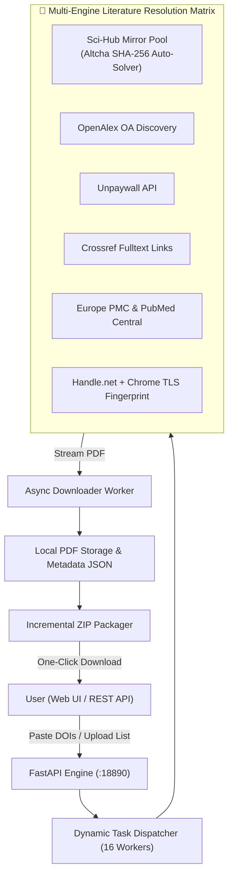

# 📚 Sci-Hub & Open Academic Literature Batch Downloader

High-throughput, asynchronous batch academic literature retrieval engine and DOI resolver proxy. Features an intelligent multi-source fallback matrix (Sci-Hub mirrors with Altcha SHA-256 solver, OpenAlex, Unpaywall, Crossref, Europe PMC, PubMed Central, Semantic Scholar, and Handle.net), a modern glassmorphism web UI with real-time SSE progress streaming, and instant ZIP archiving.

English | [中文说明](#中文说明)

---

## 🌟 Highlights

- **⚡ High-Throughput Asynchronous Pipeline**: Multi-worker concurrent queue (scalable from 4 to 24 parallel workers) backed by a 64-thread I/O pool.
- **🌐 10+ Multi-Engine Fallback Matrix**:
  - **Sci-Hub Mirror Pool**: Multi-mirror load balancing (`.ru`, `.se`, `.st`, `.wf`) with built-in Altcha SHA-256 proof-of-work auto-solver.
  - **OpenAlex OA API**: Open-access PDF discovery across institutional repositories and preprints.
  - **Unpaywall Integration**: University archives, preprint servers (arXiv, bioRxiv, medRxiv, ChemRxiv), and PMC accepted manuscripts.
  - **Publisher Direct DOI Resolvers**: Direct regex pattern matching for Nature, Springer, PLOS, BMC, Frontiers, etc.
  - **Handle.net TLS Fingerprinting**: High-speed real landing page resolution via Chrome 124 TLS client fingerprints (`curl_cffi`).
- **📦 Incremental ZIP Packaging**: Streams downloaded PDFs into an organized archive on the fly without locking CPU or disk I/O.
- **💎 Glassmorphism Web Console**: Upload CSV / TXT lists or paste dozens of DOIs at once. View real-time progress bars, failed DOI retry options, and one-click ZIP download.
- **🐳 Docker & Docker-Compose Ready**: Simple one-command deployment.

---

## 🏗️ Architecture



---

## 🚀 Quick Start

### 1. Run with Docker Compose (Recommended)
```bash
git clone https://github.com/minglu-lin/scihub-batch-downloader.git
cd scihub-batch-downloader

docker compose up -d
```
Access the web dashboard at `http://localhost:18890`.

### 2. Run Directly on Host
```bash
git clone https://github.com/minglu-lin/scihub-batch-downloader.git
cd scihub-batch-downloader

# Install dependencies
pip install -r requirements.txt

# Run server
python server/scihub_batch_server.py
```

### 3. Nginx Reverse Proxy Setup
Copy `nginx/scihub.conf` to `/etc/nginx/sites-available/scihub.conf`, edit your domain and SSL certificates, then reload Nginx:
```bash
sudo ln -s /etc/nginx/sites-available/scihub.conf /etc/nginx/sites-enabled/
sudo nginx -t && sudo systemctl reload nginx
```

---

<a name="中文说明"></a>
## 🇨🇳 中文说明

针对高并发文献调研与学术追溯打造的高吞吐、全自动学术文献批量下载与 DOI 解析平台。

### 核心亮点
1. **纯开放文献库矩阵**：聚合 Sci-Hub 四镜像负载均衡（自带 Altcha SHA-256 算力验证码秒解）、OpenAlex OA 全文挖掘、Unpaywall 高校机构库、Crossref 全文直链、EuropePMC 与 PubMed Central。
2. **Handle.net + Chrome 124 TLS 指纹嗅探**：采用 `curl_cffi` 模拟真实浏览器指纹解析落地页，秒级提取 `citation_pdf_url`。
3. **64 线程高并发 I/O 深度调优**：突破 Python 默认线程池瓶颈，单机支持 16~24 路并发下载，增量流式写入 ZIP 压缩包。
4. **现代化响应式大盘**：支持批量粘贴 DOI 或上传包含 DOI 的文本/表格文件，实时图表可视化展示下载队列与来源分布。

---

## 📄 License

Licensed under the [MIT License](LICENSE).
